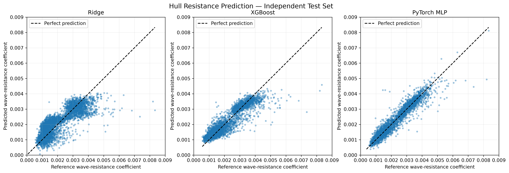
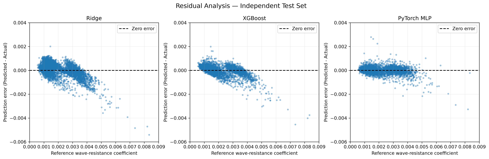

# Predicting DTMB 5415 Wave Resistance: PyTorch MLP vs XGBoost vs Ridge

A comparative, reproducible supervised-learning portfolio project for numerical hydrodynamic surrogate modelling. Uses the published DTMB 5415 design-space benchmark to predict a **wave-resistance coefficient Cw** for parametrically varied hulls at three Froude numbers. The original labels come from **WARP linear potential-flow calculations** (not high-fidelity RANS CFD, experiments, or total ship resistance).

## Dataset and research question

9,001 hull geometries (one reference, 9,000 variants) × Fr = 0.25, 0.33, 0.41 → 27,003 rows. Features: 27 normalised design parameters plus Froude number (28 inputs). Target: numerical Cw. See [DATASET.md](DATASET.md) for source citation, download and fidelity limits.

**Question:** How do Ridge, gradient-boosted trees and an MLP compare on unseen geometries sampled from this DTMB design family?

## Evaluation methodology

`prepare_data.py` constructs inputs and applies `GroupShuffleSplit` by hull identifier, so the same hull's three speeds never cross splits: train **6,300 hulls / 18,900 rows**; validation **1,350 hulls / 4,050 rows**; test **1,351 hulls / 4,053 rows**. Feature `StandardScaler` fits only training data; the MLP also uses a training-only target scaler. Validation controls model selection; held-out test assesses selected models. Seed 42.

- Ridge baseline; validation alpha sweep, selected alpha=100.
- XGBoost boosted trees; validation-based depth/learning-rate experiments, selected depth=8, learning rate=0.03.
- PyTorch feedforward MLP with ReLU, Adam and early stopping; validation-selected hidden layers **128 → 64**.

## Held-out test metrics

| Model | MAE | RMSE | R² |
|---|---:|---:|---:|
| Ridge | 0.00044555 | 0.00059827 | 0.6781 |
| XGBoost | 0.00028435 | 0.00041778 | 0.8430 |
| PyTorch MLP | **0.00019316** | **0.00028845** | **0.9252** |

Spearman ranking correlation (reference Cw vs predicted Cw, for 1,351 held-out hulls at each speed):

| Fr | Ridge | XGBoost | MLP |
|---|---:|---:|---:|
| 0.25 | 0.3722 | 0.6358 | **0.8204** |
| 0.33 | 0.7649 | 0.8138 | **0.9201** |
| 0.41 | 0.1812 | 0.7455 | **0.8676** |

Test results: [`results/test_metrics.csv`](results/test_metrics.csv), [`results/froude_metrics.csv`](results/froude_metrics.csv) and [`results/ranking_metrics.csv`](results/ranking_metrics.csv).





## Reproducing the published evaluation (from project root)

The scripts currently use working-directory-relative paths: launch them in the repository root. Python **3.14.6** and the library versions in `requirements.txt` are **reported development settings**, not independently tested clean-install compatibility. Verify your environment and dependency availability before running.

```powershell
python -m venv .venv
.\.venv\Scripts\Activate.ps1
python -m pip install -r requirements.txt
python evaluate_models.py
python evaluate_hull_rankings.py
python plot_model_predictions.py
python plot_residuals.py
```

The included `processed_data/dataset.npz` and trained model artefacts support the **saved-model evaluation without the 1.09 GB raw `.mat` file**. Saved `.joblib` / `.pth` models should only be loaded from trusted sources. To reproduce **preprocessing and training**, acquire the original dataset separately and place it in the root as `DTMB5415-database.mat`, then run `python prepare_data.py`, followed by the documented training scripts. **Warning:** rerunning preprocessing/training replaces saved artefacts; preserve a copy if you want to compare. The `train_mlp.py` script is an exploratory configuration; the final 128→64 architecture was trained by `compare_mlp_architectures.py`. Models can vary under different libraries, CPU/GPU configurations, or seeds.

## Interpretation and limits

MLP outperforms these Ridge and XGBoost variants on the held-out DTMB design-family test set. Large per-hull prediction errors remain, and rankings do not establish optimal-hull identification. The solver is low fidelity, negative Cw targets exist, individual geometry feature definitions are not documented, and there is no towing-tank validation. No numerical speed-up over the original solver has been benchmarked. This project does **not** implement generative AI, a physics-informed neural network, or a complete optimisation loop. Future directions include generative hull candidate screening, constraint checks, top-k evaluation, solver verification and wider hull-family testing.

## Code structure

- `inspect_data.py`, `prepare_data.py`: raw matrix inspection and preprocessing.
- `train_baseline.py`, `save_ridge_model.py`: baseline and saved Ridge model.
- `train_mlp.py`, `compare_mlp_architectures.py`: PyTorch model experiments.
- `train_xgboost.py`, `compare_xgboost_depth.py`, `compare_xgboost_learning_rates.py`, `train_xgboost_final.py`: tree model development.
- `evaluate_models.py`, `evaluate_hull_rankings.py`: held-out test metrics and rank agreement.
- `plot_model_predictions.py`, `plot_residuals.py`: figures.

## Sources

- Serani and Diez, **DTMB 5415 Design-Space Dimensionality Reduction Benchmark Dataset**: https://doi.org/10.5281/zenodo.19222008
- Original README and metadata copied in `source_documentation/`. 
